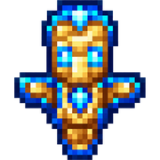

<div align="center">



# One Life Hardcore

### A real hardcore Minecraft SMP, where death actually matters.

You only get one life. Build your base, explore the world, make allies, take risks and survive for as long as you can.
**Once you're dead, your journey is over.**

[](https://onelifehardcore.net)
[](https://onelifehardcore.net)
[](https://discord.gg/xR55H8zGD4)

```
play.onelifehardcore.net
```
<sub>Java & Bedrock 26.3 · Bedrock port 19132 · other Java versions via ViaVersion</sub>

</div>

---

## 🎮 The servers

<table>
<tr>
<td width="50%" valign="top">

### ☠️ One Life Hardcore
The original. **Die once and you're out for good.** No respawns, no second chances, and strong anti-cheat so every
fight is fair.

[About the server →](https://onelifehardcore.net/onelifehardcore)

</td>
<td width="50%" valign="top">

### ⏳ Semi Hardcore
Hardcore with a second chance. **Die and you're banned for 2 weeks**, or go **Ironman** and keep it to one life.
It adds a custom world, 81 custom enchantments, levelled mobs, Blood Moons, zombie hordes, relics and 1,000+ advancements.

[About Semi Hardcore →](https://onelifehardcore.net/semihardcore)

</td>
</tr>
</table>

## 📊 By the numbers

<div align="center">

| 👥 Players | 💀 Deaths | ⛏️ Blocks mined | 🧭 Distance travelled | 🔌 Custom plugins |
| :---: | :---: | :---: | :---: | :---: |
| **1,600+** | **870+** | **3.8 M+** | **42,000+ km** | **38** |

</div>

## ✨ Built in-house

Almost everything you see in game and on the website is made by us: the death bans, the anti-combat-log, the
Lobby queue, teams, wills, ghosts, stat cards, item history, Blood Moons, the Discord bridge, the
[community wiki](https://onelifehardcore.net/wiki) and the staff dashboard.

<div align="center">


**[Website](https://onelifehardcore.net)** · **[Wiki](https://onelifehardcore.net/wiki)** · **[Network](https://onelifehardcore.net/server-info)** · **[Store](https://onelifehardcore.net/store)** · **[Discord](https://discord.gg/xR55H8zGD4)**

</div>
